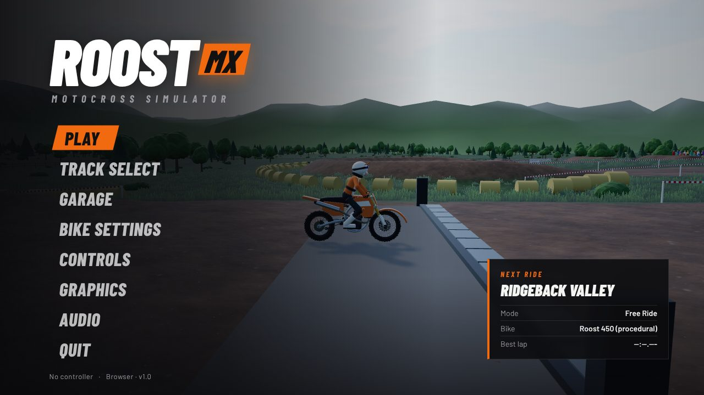

# Roost MX — Motocross Simulator

A 3D motocross riding game built with **HTML, CSS, JavaScript, Three.js and Electron**.
Ride a motocross bike with a custom physics model (suspension, tire grip, engine and
gearbox, jumps, air control and physics-driven crashes) on three generated tracks, in
Free Ride or Time Trial, with keyboard or gamepad. Import your own bike models in the
garage and ride them.

Everything (bike, rider, tracks, textures, sounds) is generated in code, so the game
runs **fully offline** and needs no asset downloads.



---

## Quick start

Requirements: [Node.js](https://nodejs.org) 18 or newer (with npm). A GPU with WebGL 2.

```bash
npm install
```

```bash
npm start
```

`npm start` bundles the game (`dist/game.js`) and opens it in an Electron window.

### Play in a browser instead

```bash
npm run serve
```

Then open <http://localhost:8765>. (After `npm run bundle` you can also open
`index.html` directly from disk in Chrome or Edge.)

## Building the Windows .exe

```bash
npm run build
```

Creates the installer **`release/Roost MX Setup.exe`** (choose install folder, desktop and
Start-menu shortcuts, uninstaller).

```bash
npm run build:portable
```

Creates the portable **`release/Roost MX.exe`** — a single file that runs without
installation.

```bash
npm run build:all
```

Builds both. Run these on Windows. On Linux/macOS the portable build works as-is, but
electron-builder needs [Wine](https://www.winehq.org/) to create the NSIS installer.

The app runs in its own window (no browser UI), starts maximized and switches to
fullscreen if that setting is on. **F11** or **Alt+Enter** toggles fullscreen at any time.

## Controls

### Keyboard (rebindable in Controls)

| Action | Key |
|---|---|
| Throttle | W |
| Rear brake | S |
| Steer left / right | A / D |
| Front brake | Space |
| Lean forward / back | ↑ / ↓ |
| Shift up / down | E / Q |
| Reset bike | R |
| Change camera | C |
| Look back | B (hold) |
| Pause | Esc |
| Fullscreen | F11 or Alt+Enter |

Menus: arrow keys, Enter and Esc, or the mouse.
Free camera: drag to look, scroll to move, I/J/K/L to fly, U/O down/up, Shift = faster.
In the other cameras, dragging the mouse orbits the view and the wheel changes distance.

### Gamepad (Xbox-style and generic controllers)

| Action | Button |
|---|---|
| Steer / lean | Left stick (X / Y) |
| Throttle | RT (analog) |
| Brake (front + some rear) | LT (analog) |
| Rear brake | X |
| Shift up / down | RB / LB |
| Reset bike / confirm | A |
| Look back / back | B |
| Change camera | Y |
| Camera orbit | Right stick |
| Pause | Start |

Controllers are detected automatically, with an on-screen message on connect and
disconnect (the game pauses if the controller disconnects while riding). Steering
sensitivity and stick deadzone are adjustable.

## Game modes and tracks

- **Free Ride** — ride anywhere on the map with no time limit, jump, crash and reset.
  An optional lap timer runs when you follow the track (turn it off in
  Graphics → *Lap timer in Free Ride*).
- **Time Trial** — 3-2-1 countdown and gate drop, lap timer from the finish line,
  ordered checkpoints with split times against your best lap, invalid-lap detection
  (cuts, wrong way, leaving the track). Best laps and splits are saved on this computer.

| Track | Type | Length |
|---|---|---|
| Ridgeback Valley | Outdoor motocross | 1.4 km |
| Pine Hollow Practice | Compact practice track | 0.7 km |
| Dune Coast | Sand track by the sea | 1.0 km |

Tracks include a start straight with a working starting gate, bermed corners, doubles,
a triple, tabletops, a step-up, a rhythm section, whoops, rollers, braking bumps and
elevation changes, plus trackside tape, banners, tire walls, hay bales, bleachers with
spectators, a timing tower, pits, fences, trees and distant mountains or dunes.
Dirt, grass, gravel and sand each have their own grip and rolling resistance.

## Features

**Physics** (`src/physics.js`, 240 Hz fixed step, frame-rate independent)
- 6-DOF rigid body for bike + rider with gravity, aero drag and rolling resistance.
- Wheel contact on the heightfield with edge detection for lips, steps and crests.
- Progressive spring + compression/rebound damping per wheel, bottoming cone,
  tire compliance; the rider's legs are a sprung mass that soaks up impacts.
- Combined-slip tire model (slip ratio and slip angle share one friction circle),
  tire relaxation, surface-dependent grip. Wheelspin, rear slides, locked-wheel skids.
- Engine with a torque curve, auto clutch, rev limiter, engine braking and a 5-speed
  gearbox (automatic or manual).
- Lean-to-steer bike model: the rider leans toward a target based on input, speed and
  available grip (including berm banking); the front wheel steers to balance the lean.
  Front and rear brakes with weight transfer, stoppies, wheelies, countersteering.
- Air control: body English (lean), throttle/brake gyroscopic pitch, whips that must be
  straightened before landing.
- Crashes come from the physics: handlebars/head/fenders touching the ground, landing
  leaned or sideways, nose-diving, casing a jump, front-end tucks from overloading the
  front tire (e.g. braking hard while leaned), and hitting obstacles. The rider
  separates and tumbles as a ragdoll; reset with R/A or automatically.
- **Rider assists** (Full / Low / Off): wheelie and stoppie control, traction control,
  brake modulation when leaned, grip-aware lean and landing assist. Off = raw sim.

**Visuals** — procedural bike with spoked wheels, knobby tires, USD forks, swingarm,
linkage shock, exhaust, plastics and number plates; rider with helmet, goggles, jersey,
gloves, pants and boots posed by two-bone IK each frame (standing/sitting, leaning,
weight shifting, foot dab in corners, absorbing landings). Dirt roost, dust, landing
bursts and tire marks. Sky with clouds, sun shadows, fog, image-based lighting.

**Cameras** — Chase, Close chase, Helmet (first person), Free camera; look back;
smooth transitions; terrain collision avoidance.

**HUD** — speed (km/h or mph), gear and gearbox mode, RPM bar with shift light, lap,
current/best/last lap, split delta, airtime, crash message, minimap, optional FPS.

**Audio** (Web Audio, procedural) — single-cylinder engine synthesized in an
AudioWorklet (pitch and tone follow rpm and load), wind, tire skids, roost, landings,
crashes, gear shifts, countdown, checkpoint and menu sounds. Master/engine/effects volume.

**Settings** (saved automatically) — steering sensitivity, engine power, suspension
stiffness and damping, front/rear brake strength, rider assists, gearbox, camera
sensitivity and distance, controller sensitivity and deadzone, bike color and race
number, key bindings, graphics quality, fullscreen, speed units, minimap, FPS, volumes.

**Graphics presets** — Low: no shadows, 75% render scale, no grass, sparse trees,
coarser terrain, no antialiasing. Medium: shadows, full render scale, some grass.
High: 2K soft shadows, up to 1.5× render scale on high-DPI screens, dense grass and
forests, full-detail terrain near the track. (Antialiasing changes apply after a restart.)

## Garage and custom bikes

Open **Garage** from the main or pause menu. Drag to rotate, scroll to zoom.

- **Bikes** — the procedural Roost 450 plus every bike you imported; pick the active one.
- **Paint** — red, blue, green, black, white, orange, yellow or any custom color, and
  your race number. For imported models, tick which materials take the paint color.
- **Import** — choose files or drag them onto the window:
  - **GLB (recommended)** and **GLTF** (select the .gltf with its .bin and texture files,
    or put them in a .zip). Materials, textures, hierarchy and animations are kept.
    Draco- and Meshopt-compressed GLBs are supported.
  - **OBJ** (+ .mtl and textures; select them together), **FBX** (FBX 7.x binary or
    ASCII, via the three.js FBX loader — very old FBX versions are not supported), and
    **ZIP** archives of any of these.
  - **PKZ** packages (see below).
- **Adjust** — scale (log slider, so centimetre and millimetre models work), position
  X/Y/Z, rotation X/Y/Z, rider offset and visibility, model animation; *Auto-fit to
  wheels*, *Reset adjustments*, *Save configuration*, *Apply & use*.
- **Parts** — assign the bike root (everything outside it, such as a stand or ground
  plane, is hidden), front wheel, rear wheel, steering assembly, handlebar, front
  fork (sliding part), swingarm/rear suspension and rider attachment point. Parts are
  auto-detected from names (e.g. `wheel_front`, `Rear_Tyre`, `fork`, `swingarm`, also
  some German/French/Italian/Spanish names) or by geometry (two disk-shaped parts at the
  ends of the model). You can also pick parts by clicking the model or from the node
  list. *Preview motion* animates steering, suspension and wheel spin to check it.

When you ride an imported bike it is driven by the same physics as the procedural one:
its wheels spin and follow the suspension, the steering parts turn around the steering
axis, the fork slides, the swingarm pivots, and the whole bike leans, pitches, jumps and
lands with the physics body. Imported bikes and their settings are stored on this
computer (IndexedDB).

### About .pkz files (MX Bikes mods)

`.pkz` is the package format used by PiBoSo games such as MX Bikes. Roost MX opens a
.pkz as a ZIP archive and lists everything inside it in an import report:

- If the package contains a **GLB, GLTF, FBX or OBJ** model, it is extracted and loaded.
- Bike meshes in MX Bikes mods are normally stored as **`.edf`** files, and paints as
  **`.pnt`**. These are proprietary, undocumented PiBoSo formats. **Roost MX cannot read
  them** and says so in the report; it never pretends such a package loaded.
- If the file is not a ZIP container (for example encrypted), the report says that too.

To ride a bike from such a mod you need the model in an open format: get the source
model from its author (most are made in Blender or 3ds Max) or use your own model, then
export it from Blender with *File → Export → glTF 2.0*, format *glTF Binary (.glb)*,
*+Y Up*, *Apply Modifiers*, with materials/images included. Naming objects like
`wheel_front`, `wheel_rear`, `fork`, `handlebar` and `swingarm` makes the setup
automatic. Please respect mod licences: many do not allow extracting, converting or
redistributing their models.

## Project structure

```
RoostMX/
  index.html, styles.css        UI shell and styling
  electron-main.js              Electron main process (app:// protocol, window, IPC)
  electron-preload.js           safe bridge: fullscreen, quit
  package.json                  scripts and electron-builder config
  src/
    main.js                     game states, main loop, ride logic, effects
    physics.js                  bike physics, engine, crashes, ragdoll
    bike-geometry.js            shared bike dimensions (physics and visuals)
    bike.js                     procedural bike model and its animation
    bike-importer.js            GLB/GLTF/FBX/OBJ/PKZ import, part detection, binding
    rider.js                    rider model, IK posing, crash pose
    track.js, tracks.js         track layout builder, features, terrain generation
    heightfield.js              terrain data and surface types
    terrain-render.js           chunked LOD terrain and splat shader
    environment.js              sky, lights, vegetation, trackside props, colliders
    colliders.js                static collision shapes
    camera.js                   camera modes
    controls.js, controller.js  keyboard and gamepad input
    audio.js                    procedural audio
    particles.js                roost/dust particles and tire marks
    timing.js                   lap timer and checkpoints
    ui.js                       menus, settings, HUD, minimap
    garage.js                   garage scene and import workflow
    settings.js, storage.js     saved settings, records and imported bikes
    textures.js, util.js        procedural textures, math helpers
  assets/                       fonts (OFL) and icons
  scripts/                      bundler, icon generator, track analyzer
  tests/                        physics, timing, autopilot and browser tests
```

## Tests

```bash
npm test
```

Physics checks (rest, acceleration, braking, cornering, jumps, crash cases).

```bash
node tests/timing-test.mjs
```

Lap timer: laps, splits, cut / wrong-way / off-track detection.

```bash
npm run test:autopilot
```

A simple autopilot rides every track headless and reports crashes and lap times.

Browser tests (`tests/smoke.cjs`, `tests/flows.cjs`, `tests/gamepad.cjs`) and the
Electron smoke test (`tests/electron-smoke.cjs`) use [Playwright](https://playwright.dev);
start `npm run serve` first. `node tests/make-fixtures.mjs` regenerates the importer
test files in `tests/fixtures/`.

## Troubleshooting

- **Black screen / "Could not start"** — the game needs WebGL 2. Update your graphics
  driver. On laptops, make sure the app uses the dedicated GPU.
- **Low frame rate** — use Graphics → Low or Medium, or a smaller window. On first
  launch the game picks a preset from your GPU (integrated graphics start on Medium).
- **No sound** — click or press a key once (browsers only start audio after input) and
  check the Audio volumes.
- **Controller not detected** — press any button on it; Windows browsers only expose a
  pad after an input.
- Developer tools in the desktop app: Ctrl+Shift+I.

## Known limitations

- PiBoSo `.edf` meshes and `.pnt` paints inside `.pkz` files are not supported (see above).
- Imported models are fitted to the built-in physics geometry (1.48 m wheelbase); the
  physics does not change with the model's dimensions or mass.
- Rear shock and linkage parts of imported models move with the swingarm rather than
  compressing.
- No AI opponents or multiplayer.
- The NSIS installer has to be built on Windows (or with Wine).

## Licences

Code: MIT. Three.js: MIT. Electron: MIT. Barlow and Barlow Condensed fonts: SIL Open
Font License 1.1 (`assets/fonts/OFL-LICENSE.txt`). All sponsor names on trackside
banners are fictional.
